# VATSIM Control Recommendations - User Guide

A comprehensive guide for installing and using the VATSIM Control Recommendations terminal application.

## Table of Contents

- [Introduction](#introduction)
- [Installation](#installation)
- [Quick Start](#quick-start)
- [Command-Line Options](#command-line-options)
- [User Interface Overview](#user-interface-overview)
- [Keyboard Shortcuts](#keyboard-shortcuts)
- [Features](#features)
  - [Flight Boards](#flight-boards)
  - [Flight Information](#flight-information)
  - [Go To Navigation](#go-to-navigation)
  - [Grouping Builder](#grouping-builder)
  - [Weather Lookups](#weather-lookups)
  - [Weather Briefings](#weather-briefings)
  - [VFR Alternatives Finder](#vfr-alternatives-finder)
  - [Diversion Airport Finder](#diversion-airport-finder)
  - [Historical Flight Statistics](#historical-flight-statistics)
  - [Tracked Airports Manager](#tracked-airports-manager)
  - [Command Palette](#command-palette)
- [Groupings file (custom_groupings.json)](#groupings-file-custom_groupingsjson)
- [My groupings](#my-groupings)
- [Weather Data Sources](#weather-data-sources)
- [Visual Features](#visual-features)
- [Tips & Tricks](#tips--tricks)
- [Troubleshooting](#troubleshooting)

---

## Introduction

VATSIM Control Recommendations is a terminal-based application that analyzes live VATSIM flight data and provides controller staffing recommendations. It displays real-time airport statistics including:

- **Departures**: Aircraft on the ground ready to depart
- **Arrivals**: Aircraft inbound with ETAs
- **Wind & Weather**: Current conditions from aviation weather sources
- **Staffed Positions**: Which ATC positions are online

Around those tables it offers flight boards, flight information, weather lookups and briefings, diversion and VFR alternative finders, historical statistics, and Go To search with your own saved groupings.

The application is built using the Textual framework, providing a rich terminal UI with features like split-flap animations, searchable tables, and detailed flight information modals.

---

## Installation

### Prerequisites

- **uv** ([Install uv](https://docs.astral.sh/uv/getting-started/installation/)); it fetches Python 3.13 itself if you don't have it
- **Terminal** with UTF-8 support (Windows Terminal, iTerm2, or similar)

### Step 1: Clone or Download the Repository

```bash
git clone https://github.com/leftos/vatsim_control_recs.git
cd vatsim_control_recs
```

### Step 2: Run the Application

```bash
uv run main.py
```

**That's it!** `uv run` handles everything else:

1. **Fetches Python 3.13** if no suitable Python is installed
2. **Creates a virtual environment** (`.venv`) in the application directory
3. **Installs the locked dependencies** from `uv.lock`, including the spaCy language model (`en_core_web_sm`) for airport name processing

On first run, you'll see uv's progress as dependencies are installed. Subsequent launches start immediately.

### Optional: Historical Statistics API Key

To use the Historical Flight Statistics feature (`Ctrl+S`), you need a free API key from statsim.net:

1. Get a key at https://statsim.net/api-keys
2. Create a `.env` file in the application directory:
   ```
   STATSIM_API_KEY=your-key-here
   ```
   Or set the `STATSIM_API_KEY` environment variable directly.

### Verifying Installation

To verify everything is set up correctly without launching the full app:

```bash
uv run main.py --help
```

You should see a list of available command-line options.

---

## Quick Start

### Track All Airports (Default)

```bash
uv run main.py
```

With no filter the app tracks every airport that has traffic, which is slow on a busy network. Prefer `--airports`, `--groupings` or `--countries`.

While you track everything, Go To lists no airports and Historical Statistics asks you to track some first; pick a filter, or use the Tracked Airports Manager, to use them.

### Track Specific Airports

```bash
uv run main.py --airports KSFO KLAX KJFK KORD
```

Type ICAO codes in capitals: `--airports` does not fold case the way `--groupings` names do.

### Track all airports within an ARTCC, including separate arrival counts for time-limited ETA and all arrivals

```bash
uv run main.py --groupings "ZOA All" --include-all-arriving
```

### Track All Airports in Specific Countries

```bash
uv run main.py --countries US CA
```

### Track Groupings

```bash
uv run main.py --groupings O90 FAT
```

Grouping names are matched ignoring case but must otherwise be exact, and a name can be a preset (`O90`, `NCT Combined`), an ARTCC grouping (`ZOA All`), one from the groupings file (`FAT_APP`) or one of your own ★ groupings. A name that is not found prints a warning at start-up, and if none of the names match, the app tracks every airport.

### Combine Multiple Filters

```bash
uv run main.py --airports KSFO --groupings "NCT Combined" --include-all-staffed
```

---

## Command-Line Options

| Option | Default | Description |
|--------|---------|-------------|
| `-h`, `--help` | | Show the option list and exit |
| `--airports ICAO [ICAO ...]` | (all) | Track specific airports by ICAO code (in capitals) |
| `--countries CODE [CODE ...]` | (none) | Track all airports in specified countries (e.g., `US`, `DE`, `CA`) |
| `--groupings NAME [NAME ...]` | (all) | Track airports from groupings: presets, ARTCC groupings or your own |
| `--max-eta-hours HOURS` | 1.0 | Maximum ETA in hours for the Arr count (flights further out are not counted there). `0` turns the limit off: Arr counts every inbound, the column header reads `ARR (all)`, and the `arr/arr_all` form disappears |
| `--refresh-interval SECS` | 15 | Minimum whole seconds between refresh starts; a refresh never starts while one is running, so a slow analysis lengthens the period |
| `--include-all-staffed` | false | Include airports with no traffic if an ATC position is online (airports without a tower never count) |
| `--include-all-arriving` | false | Also list airports and groupings whose only traffic is flights filed to them, whatever their ETA (they show Arr 0 with the filed count after the slash) |
| `--disable-animations` | false | Disable split-flap animations for instant updates |
| `--wind-source SOURCE` | metar | Wind data source for the airports table and the flight board title: `metar` or `minute` |
| `--hide-wind` | false | Hide the wind column from the main table |

### Examples

**Quick startup with no animations:**
```bash
uv run main.py --disable-animations --airports KSFO KOAK
```

**Include staffed airports even with no traffic:**
```bash
uv run main.py --include-all-staffed --countries US
```

**Longer ETA window (show arrivals up to 2 hours out):**
```bash
uv run main.py --max-eta-hours 2.0
```

**Show all filed arrivals alongside ETA-filtered arrivals:**
```bash
uv run main.py --include-all-arriving --airports KSFO KLAX
```

**Use up-to-the-minute wind data:**
```bash
uv run main.py --wind-source minute
```

---

## User Interface Overview

The application has several main components:

### Header Bar

The top bar displays:
- **Application title**: "VATSIM Control Recommendations"
- **Local time**: Your local timezone
- **UTC time**: Zulu time for aviation reference

For example `Local 09:15:30 | UTC 16:15:30`.

### Main Tables

The interface has two tabs. `Tab` moves focus between the table and the tab bar, and with the tab bar focused `←` and `→` switch tabs.

#### Individual Airports Tab

Shows all tracked airports, busiest first.

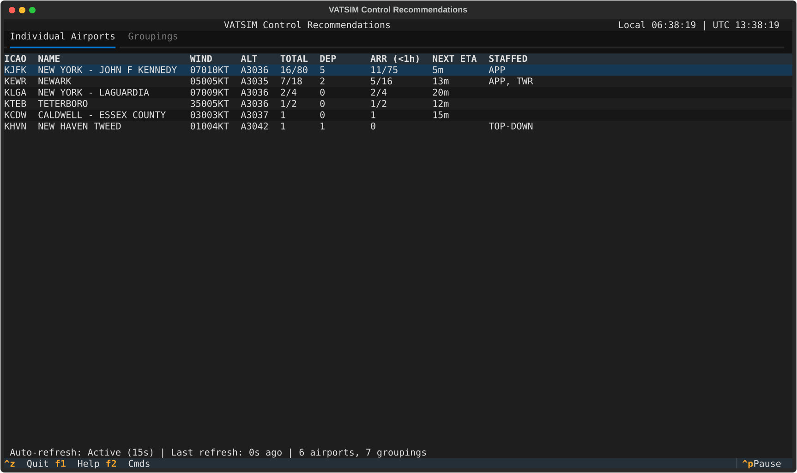

Columns:
- **ICAO**: the airport code
- **NAME**: Human-readable airport name
- **WIND**: METAR-style wind, for example `27005G12KT` (hidden by `--hide-wind`)
- **ALT**: Altimeter setting, `A2992` in inches of mercury, or `Q1013` in hPa regions
- **TOTAL**: departures plus arrivals
- **DEP**: Number of departures (aircraft on the ground)
- **ARR**: Number of arrivals: aircraft on the ground at the airport, or airborne inbound whose ETA, the one the flight board shows, is within `--max-eta-hours`. The header reads `ARR (<1h)`, or `ARR (all)` with `--max-eta-hours 0`
- **NEXT ETA**: Time until the next arrival, counting only the arrivals in the ARR column, so it never exceeds `--max-eta-hours` and matches the flight board. It reads `45m`, `<1m` or `1h05m`; `LANDED` when the next arrival is already on the ground; blank when there is none
- **STAFFED**: the online ATC positions, comma-separated (ATIS is left out when other positions exist). `TOP-DOWN` means only an ATIS is online, and `N/A` means the airport has no tower

The first screen shows traffic with WIND and ALT blank; they fill in region by region within a few seconds. On each refresh the traffic columns update first, and WIND and ALT keep their previous values until fresh weather arrives for that airport.

When the Arr count inside the time limit differs from all arrivals filed to the airport, the cell shows both, for example `3/  7` (3 inside the limit, 7 filed). TOTAL does the same with departures added. This needs no option; `--max-eta-hours 0` turns it off.

`Ctrl+F` opens a search box that matches the ICAO code, the name or the staffed position text. It works on this tab only, and `Esc` or `Ctrl+F` again clears it.

`Enter` or a double-click on a row opens its flight board.

#### Groupings Tab

Shows presets, ARTCC groupings and your ★ groupings with aggregated statistics. Enter or a double-click opens the selected grouping's flight board; a ★ grouping opens with its saved per-airport dep/arr filters, as it does from Go To.

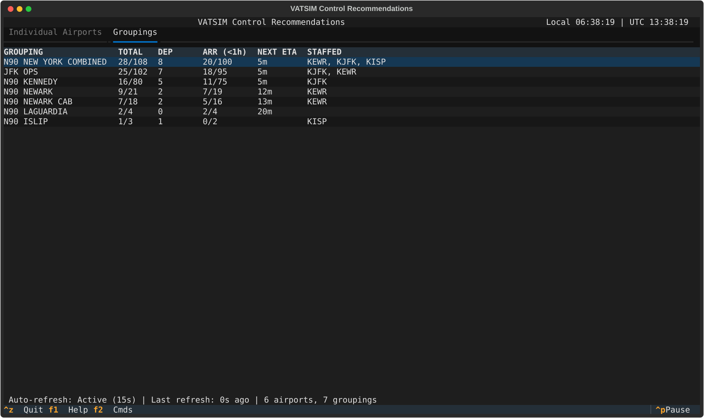

Columns are GROUPING, TOTAL, DEP, ARR, NEXT ETA and STAFFED. A grouping is listed only when it has traffic (or filed arrivals with `--include-all-arriving`). STAFFED lists the airports of the grouping that have a non-ATIS position online, not the positions themselves.

With `--groupings`, only those groupings and the groupings fully inside them are listed; without it all are.

### Status Bar

The bottom bar shows:
- **Refresh status**: `Auto-refresh: Active (15s)`, `Paused` (you pressed `Ctrl+P`), or `Auto-paused (not idle)` while you are moving around. Refreshes resume 3 seconds after you stop pressing arrow or page keys, switching tabs or typing in the search box
- **Time since last refresh**: Time since the last refresh that landed, with " · Refreshing…" added while one runs (for example `Last refresh: 47s ago · Refreshing…`; over a minute it reads `1m 05s`)
- **Tracking counts**: Number of airports and groupings being tracked

A key-hint line below it lists `Ctrl+Z` Quit, `F1` Help and `F2` Cmds.

### Row Order

Rows are ordered by activity: the busiest airport or grouping first, ties broken by total filed arrivals. The order is automatic; column headers are not clickable. Flight boards list departures by callsign and arrivals by ETA, landed flights first.

### Flight Categories (Color Coding)

When viewing weather information, airports are color-coded by flight category:
- **Green**: VFR (Visual Flight Rules - good conditions)
- **Blue**: MVFR (Marginal VFR - reduced visibility)
- **Red**: IFR (Instrument Flight Rules - poor conditions)
- **Magenta**: LIFR (Low IFR - very poor conditions)

---

## Keyboard Shortcuts

`F1` or `?` opens a help screen that lists the main-view keys only; the keys inside each screen are covered in the feature sections below.

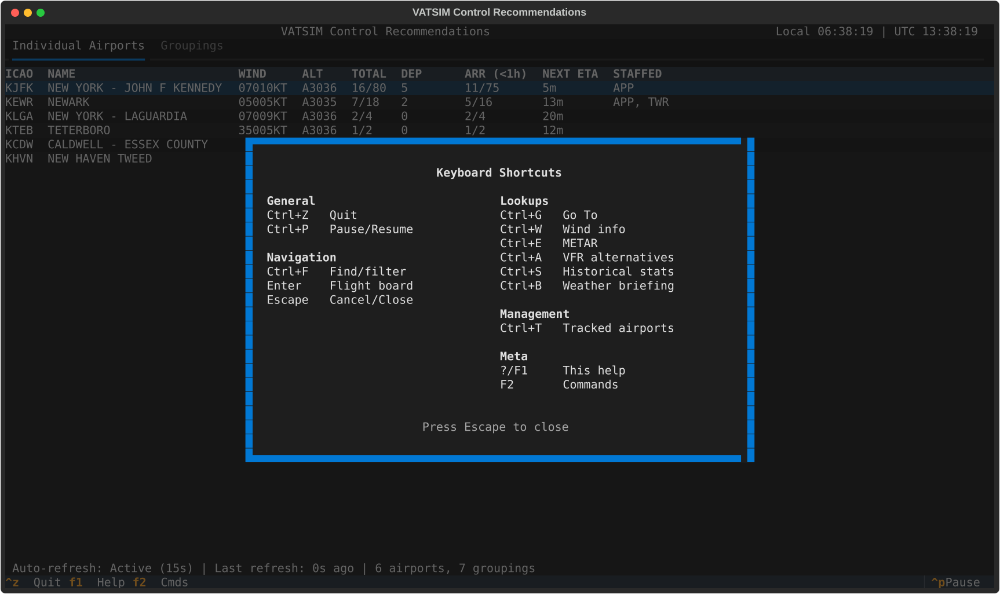

### Main View

| Shortcut | Action |
|----------|--------|
| `Ctrl+Z` | Quit the application |
| `Ctrl+P` | Pause/Resume auto-refresh |
| `Tab` | Move focus between the table and the tab bar (with the tab bar focused, `←` / `→` switch tabs) |
| `Up/Down` | Navigate table rows |
| `Page Up/Down` | Navigate table pages |
| `Home/End` | Jump to first/last row |

### Search & Navigation

| Shortcut | Action |
|----------|--------|
| `Ctrl+F` | Filter/search airports (airports tab only) |
| `Ctrl+G` or `Ctrl+L` | Open Go To modal (unified search) |
| `Enter` or double-click | Open flight board for selected airport/grouping |
| `Escape` | Close modal or cancel search |

### Weather & Information

| Shortcut | Action |
|----------|--------|
| `Ctrl+E` | METAR & TAF lookup |
| `Ctrl+W` | Wind information lookup |
| `Ctrl+A` | VFR alternatives finder |
| `Ctrl+B` | Weather briefing |
| `Ctrl+S` | Historical statistics (not while another screen is open) |

### Airport Management

| Shortcut | Action |
|----------|--------|
| `Ctrl+T` | Open Tracked Airports Manager |

### Help

| Shortcut | Action |
|----------|--------|
| `?` or `F1` | Show help screen |
| `F2` | Open command palette |

---

## Features

### Flight Boards

**Access:** Select an airport or grouping and press `Enter` (or double-click it)

The flight board shows two panels, departures on the left and arrivals on the right:

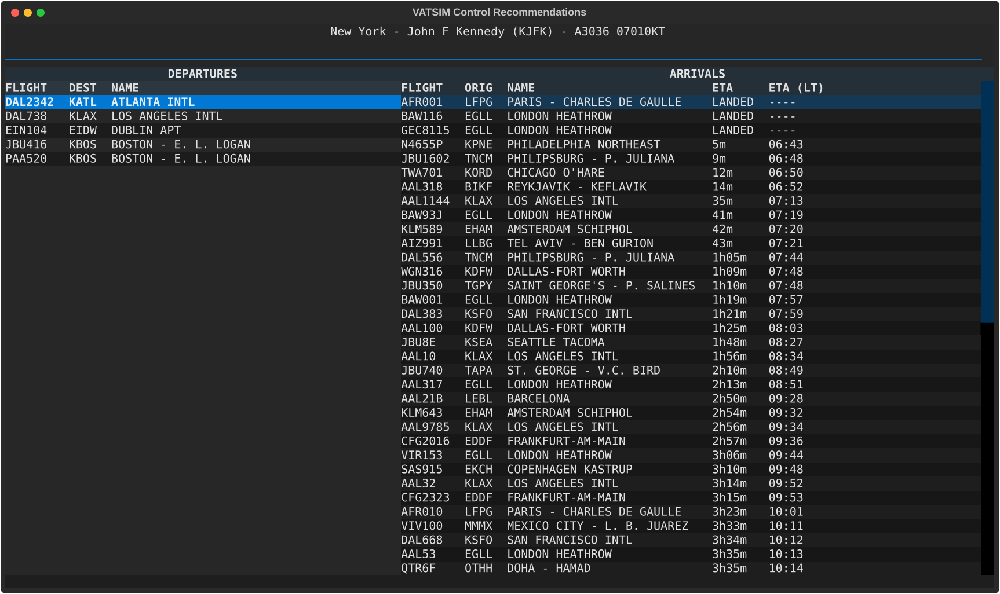

- **Departures**: Aircraft on the ground at the airport, including aircraft with no flight plan (their destination shows `----`)
- **Arrivals**: Every aircraft inbound to the airport, however far out (`--max-eta-hours` limits only the Arr count on the Individual Airports tab), including aircraft not yet departed, which show `----` for ETA. `LANDED` marks aircraft already on the ground at the arrival airport, and `LOCAL` flights (departure equals arrival) show a `----` code

Departures show FLIGHT, DEST and NAME; arrivals show FLIGHT, ORIG, NAME, ETA and ETA (LT), the ETA in your local time. The header of a single-airport board reads like `Name (KSFO) - A2992 27005KT`; the wind follows `--wind-source`.

**Grouping Flight Boards** aggregate flights from all airports in the group and add the board airport to each row: departures show FLIGHT, ORIG, NAME, DEST and NAME, arrivals FLIGHT, DEST, NAME, ORIG, NAME, ETA and ETA (LT).

**Flight Board Shortcuts:**
| Shortcut | Action |
|----------|--------|
| `Enter` | Open detailed flight information |
| `F` | Cycle direction: departures only / arrivals only / both |
| `Escape` or `Q` | Close flight board (`Escape` first clears a toast) |
| Double-click | Open flight information |

**Direction Filtering:** `F` rotates the board between departures only, arrivals only, and both. The unused column is hidden and the remaining one expands to the full width, and the header shows the active mode (`· DEPARTURES ONLY`, `· ARRIVALS ONLY` or `· CUSTOM FILTER`; nothing for both).

If the board was opened from a ★ grouping with per-airport dep/arr filters, that saved configuration is the first stop in the rotation, so you can always cycle back to it. Cycling only changes the current view — the ★ grouping itself is not modified.

**Change Toasts:** On a board for a grouping (more than one airport), the app checks the member airports every 60 seconds and shows a toast in the lower right when a member's flight category changes (`WX: KSFO now IFR (was MVFR)`), its runways in use change (`RWY:`) or the approach type on a runway changes (`APP: ... RWY 30L now ILS/RNAV`).

Toasts flash when the airport has an ATIS (runway and approach toasts always flash). Nothing fires for conditions that were already there when the board opened, a new ATIS letter alone does not trigger a toast, and single-airport boards show none. Press `Escape` to clear a toast before closing the board.

---

### Flight Information

**Access:** From a flight board, or from Go To, select a flight and press `Enter`

Displays comprehensive flight details:

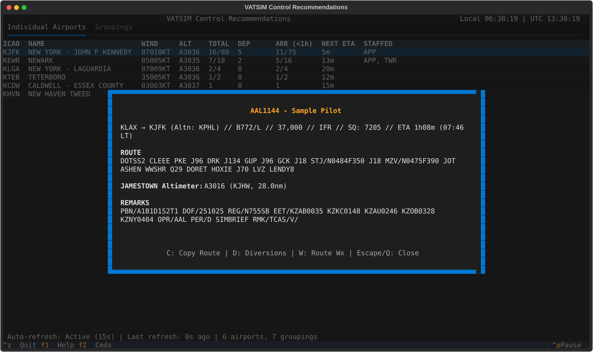

**Title:** `CALLSIGN - Pilot Name (P:1,234h / C:56h)`: the pilot's and the ATC hours from VATSIM stats, each left out when 0.

**Summary line:** departure and arrival airport codes with an alternate if filed, aircraft type with equipment suffix, filed altitude, flight rules, assigned squawk and ETA, for example `KSFO → KLAX (Altn: KSJC) // B738/L // 35,000 // IFR // SQ: 1234 // ETA 45m (14:30 LT)`. After landing the ETA reads `LANDED`, and the squawk shows only when one is assigned.

**Below it:** the full filed route (word-wrapped), any MEA lines and VFR warning described below, the nearest altimeter setting (`City Altimeter: A2992 (KSFO, 12.3nm)`, from the nearest airport with a METAR within 100 nm, biased toward the flight's heading), and the REMARKS (the first five lines, then `... (N more lines)`).

**No flight plan:** the screen reads `NO FLIGHT PLAN`, shows `On Ground at KXXX - City` when the aircraft is stopped at an airport, and still shows the altimeter.

**MEA Violation Warning:**
For IFR flights whose route uses an airway (V, J, T or Q), shows a warning if the filed level is below the Minimum Enroute Altitude for a segment of the route. This compares the filed level, not the aircraft's present altitude. Each segment is compared with the level in force at its airway's entry (a `FIX/N0450F350`-style group in the route), else the filed altitude.

The warning shows the worst segment and up to three segments, for example `Filed altitude 30,000 < required MEA 31,000` and `V1 (A→B) requires 31,000`.

Where a segment has a different MEA for each direction, the one for the direction flown is used, and the segment is labelled in that direction (for example `V1 (PLANN→INLET)`). Two airways filed back to back (`A1 A2`) are joined at the one fix they share. An airway that cannot be checked because one of its fixes is not on it gets a dim "MEA not checked" line.

**VFR Weather Warning:**
For VFR flights, lists each end of the flight with non-VFR conditions (for example `KSFO is IFR (2SM BKN004)`). For an IFR or LIFR airport it also offers up to three VFR/MVFR alternates within 100 nm; departure alternates show only while the aircraft is on the ground.

**Flight Info Shortcuts:**
| Shortcut | Action |
|----------|--------|
| `C` | Copy route to clipboard |
| `D` | Find diversion airports |
| `W` | View route weather |
| `Escape` or `Q` | Close |

The flight info screen auto-refreshes every 15 seconds.

---

### Go To Navigation

**Access:** `Ctrl+G` or `Ctrl+L`

Unified search modal for quickly navigating to:
- **Airports**: your tracked airports only (the list is empty while you track everything). Type the ICAO code or name
- **Flights**: every online pilot. Type a callsign, or the code of the airport the flight is from or to
- **Groupings**: Type grouping name

Matching is a substring match. `Enter` on an airport or grouping opens its flight board; `Enter` on a flight opens its Flight Information. Rows look like `@ KSFO - Name`, `★ Name (12 airports)`, `$ Name (N airports)` and `# AAL123 - KSFO -> KLAX`.

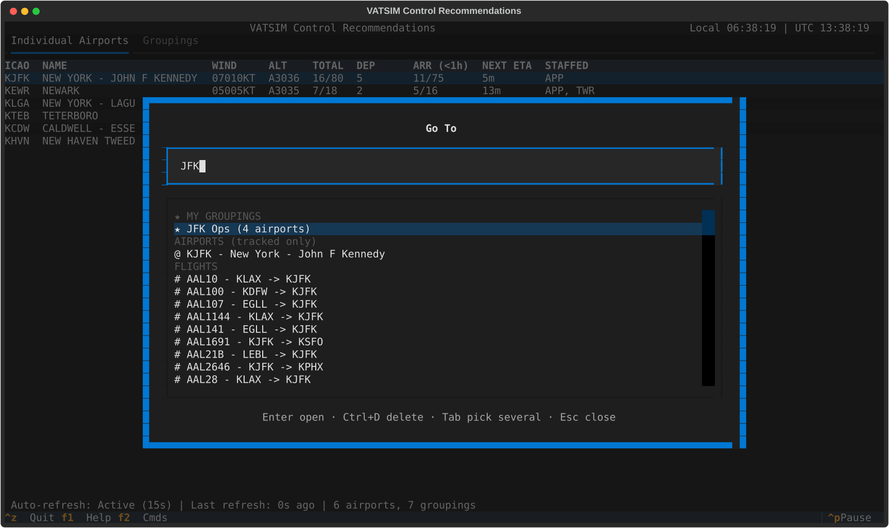

**Filter Prefixes:**
- `@` - Search airports only (e.g., `@SFO`)
- `#` - Search flights only (e.g., `#AAL123`)
- `$` - Search groupings only (e.g., `$O90`)

**Result Sections:**
The list groups its rows under dim headers, shown only when the section has rows: "★ MY GROUPINGS", "AIRPORTS (tracked only)", "GROUPINGS" and "FLIGHTS". A prefix shows only its own kind; `$` shows both grouping sections. The highlight skips the headers, and `Up` from the first row or `Down` from the last returns to the search box.

With more than 100 matching rows the list ends with a dim "showing 100 of N — type to narrow" row; type more to narrow the results.

**Title and Hint Line:**
The title names the current mode: "Go To" while browsing, "Go To · Pick several · 3 picked → 12 airports" while picking several (the picks and the airports they resolve to).

A hint line under the results lists only the keys that work right now, for the current mode, focus and highlighted row (for example "Enter open · E edit · Ctrl+D delete · Tab pick several · Esc close"). It shows at most six items; `Tab` and `Esc` are always among them, and the `←` and `→` hints are the first to give way when there are more.

**Choosing for Another Screen:**
When another screen opens Go To to choose something (for example `Ctrl+B` outside a flight board), the title is that screen's (such as "Weather Briefing: select an airport, grouping or flight"). There is no pick several, and `E` and `Ctrl+D` type into the search box. The hint line reads "Enter select · Esc close".

**Keyboard Focus:**

`Tab` toggles pick several and, when it switches it on, moves focus to the results list. With the list focused, typing a letter or other character jumps back to the search box and adds it to your search. While picking several, `E`, `F` and `Space` keep their jobs in the list; while browsing, only `E` does. `Up` and `Down` move between the search box and the list.

If a key cannot do anything (for example `E` on an airport or flight, `F` on a row that is not picked, `Enter` or `Space` on a section header or the "showing 100 of N" row, `→` on a row that is not a picked grouping, or `Ctrl+Enter` with nothing picked), a warning message tells you why.

**Multi-Select Mode ("Pick several"):**
Press `Tab` to toggle multi-select mode, which allows selecting multiple airports/groupings to open at once. Flights are hidden while you pick:
- `Enter` (search box) or `Space` (results list) - Pick or unpick the highlighted item; with `Space` the highlight stays on that item
- `Ctrl+Enter` - Open one board for all picked items. It is titled with the first three pick names and "+ N more", and every picked grouping's airports are included. Some terminals send `Ctrl+J` for `Ctrl+Enter`; that works too while picking several
- `Ctrl+S` - Open the [Grouping Builder](#grouping-builder) on the picks and their filters, to save them as a ★ grouping
- `Tab` - Back to browsing
- `Esc` - Close

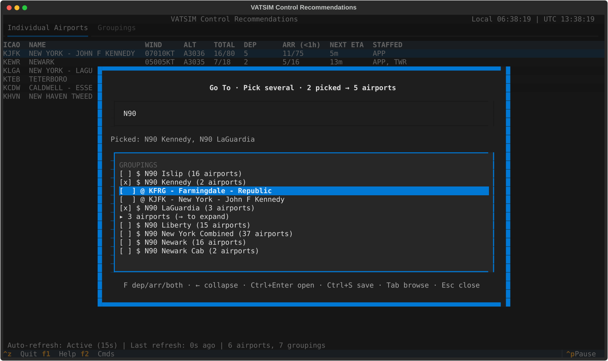

A line under the search box, "Picked: name, name, +N", lists your picks in the order you picked them, with "+N" for those that do not fit; it is hidden when nothing is picked.

**Picked Groupings:**
A picked grouping's airports show as one row, "▸ N airports (→ to expand)". Press `→` to list its airports as separate rows (the highlight lands on the first), and `←` on the grouping row or any of its airports to collapse them again. The expanded state stays while you search or switch with `Tab`, and resets when you unpick the grouping or leave pick several (a `Ctrl+S` save does).

**Per-Airport Filtering:**
In multi-select mode, press `F` in the results list on a picked airport to cycle its filter (for an airport inside a picked grouping, expand the grouping with `→` first). A picked row reads like `[x D▸] @ KOAK`, and an unpicked row shows `[ ]`:
- `[  ]` - Both departures and arrivals (default)
- `[D▸]` - Departures only
- `[◂A]` - Arrivals only

`F` on a picked grouping sets every airport in it; a setting on one airport wins over the grouping's. This filtering is preserved when saving to my groupings.

**My groupings management:**
- My groupings appear with a star prefix in the results list
- `E` - Edit a ★ grouping from the results list: opens it in the [Grouping Builder](#grouping-builder) with its name, airports and saved filters. On a preset grouping, `E` opens the builder on a copy instead: a new grouping named "{preset} copy" holding the preset's airports, ready to save with `Ctrl+S`
- `Ctrl+D` - Delete a ★ grouping; asks "Delete '{name}' from my groupings?" first
- If a delete fails, an error message names the ★ grouping and the cause
- After a `Ctrl+S` save the modal leaves pick several and shows the saved name in the search box; after an `E` save it stays as it was, with your picks (a picked grouping that was renamed stays picked under its new name)

---

### Grouping Builder

The builder is where you name a ★ grouping, choose its members and set their filters. It opens from:
- Go To: `E` on a ★ row (editing that grouping), `E` on a preset row (a new grouping copying the preset's airports, named "{preset} copy"), or `Ctrl+S` in pick several (a new grouping, prefilled with your picks and their filters)
- Tracked Airports Manager: `S` (a new grouping, prefilled with the picked airports, or the whole list when none is picked)

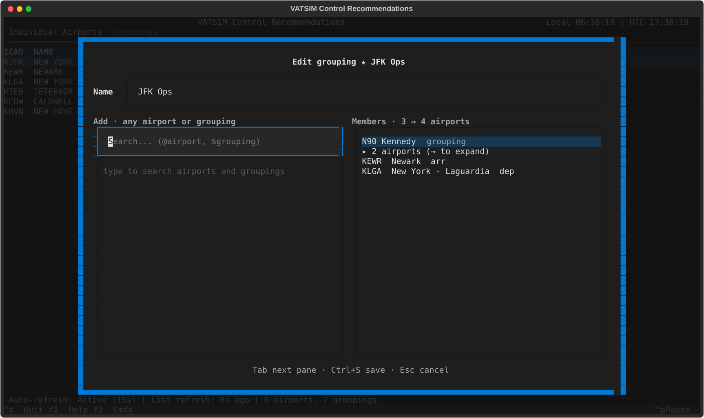

The title is "New grouping" or "Edit grouping ★ Name". From 110 columns the Add pane and the Members pane sit side by side, and `Tab` moves focus between the Name field, the Add search and the Members list. Narrower, one list shows at a time and `Tab` flips between Members and Add. `Enter` in the Name field moves to the panes, and `Up` and `Down` move between the Name field, the search box and the lists.

**Adding:** The Add search finds any airport the app knows (not only the ones you track) and any grouping. Airports come first, the ones you track ahead of the rest, then the groupings, ★ ones first. Airport rows show the names the rest of the app uses, and a row too wide for the list is cut to one line with "…" in its name.

Prefix with `@` for airports only or `$` for groupings only. It shows at most 50 rows, then a dim "showing 50 of N — type to narrow" row. `Enter` adds the highlighted result; one already in the grouping is marked "member". An airport you do not track carries a `○` mark, and the hint line then shows "○ not tracked".

**Members:** The pane title counts members and the airports they resolve to ("Members · 3 → 14 airports"). A member with a dep/arr filter shows `dep` or `arr` after its name. A nested grouping shows as one row with a folded "▸ N airports (→ to expand)" row under it.
- `Del` - Remove the highlighted member. On an airport of an expanded nested grouping it leaves out that airport only, replacing the grouping with its other airports
- `F` - Cycle the highlighted airport's filter: both, then dep, then arr
- `→` - Expand a nested grouping into its airports
- `←` - Collapse them again, from the grouping row or any of its airports

**Saving:** `Ctrl+S` saves; `Esc` cancels, and when you changed anything it first asks "Discard this new grouping?", or when editing "Discard your changes to 'Name'?" with the saved name, whatever is typed in the Name field.
- A name is required. A name that is a preset grouping's, or a known airport ident, is refused with the reason shown under the Name field, even when it is also a member; a grouping that would contain itself is refused too
- If the airport data is still loading, a message asks you to try again in a moment
- If the name is already one of your groupings you are asked first "'Name' is already one of my groupings. Replace it?"; renaming onto another of your groupings asks "'New' is already one of my groupings. Replace it with this one? ('Old' is removed)". No saves nothing
- If some of the airports are not tracked, a choice then appears: "N of these aren't tracked (KAAA, KBBB). Add them to your tracked airports?" with "Add and save" (`1`), "Save only" (`2`) and "Cancel" (`3`)

---

### Weather Lookups

Both lookups take an airport code: type it and press `Enter` to fetch, `Esc` closes. The code is pre-filled from context, in this order: a diversion's selected row, the flight's airport (the arrival once airborne, the departure on the ground), the flight board's selected row, else the highlighted airport on the Airports tab. The first `Backspace` clears an auto-filled code.

#### METAR & TAF Lookup (`Ctrl+E`)

Shows the airport name with its flight category (`// VFR`), then:

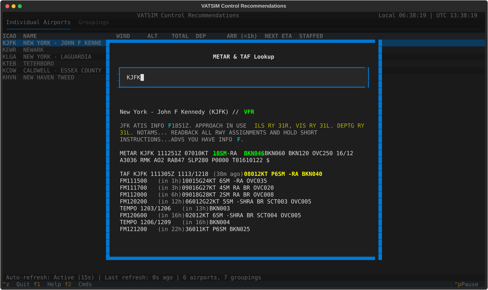

- The ATIS: VATSIM's first, else the real-world D-ATIS marked `(RW)`; departure and arrival ATIS get `DEP:` and `ARR:`
- A `SPECI` flag for special reports
- The raw METAR, with the visibility and ceiling that set the category underlined in the category colour
- The TAF, with the period in force highlighted and each period's start shown as `(in 2h)` or `(1h ago)`

For an IFR or LIFR airport the hint line offers `Ctrl+A` for the VFR alternatives finder, which opens already filled in.

#### Wind Information Lookup (`Ctrl+W`)

Shows the airport name, then the `METAR:` wind and the `Minute:` wind (weather.gov), each like `27005G12KT` or `No data available`, and says which one is the active source (set with `--wind-source`).

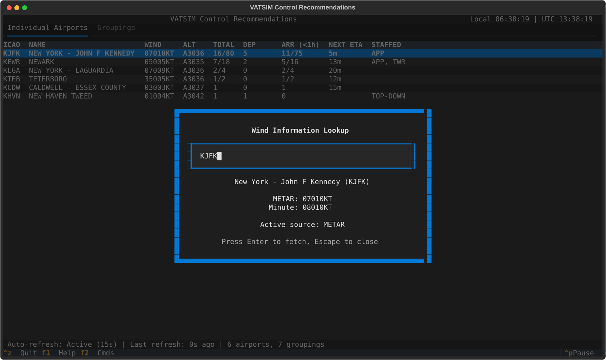

---

### Weather Briefings

#### Weather Briefing (`Ctrl+B`)

**Access:** Press `Ctrl+B`. With a flight board open it goes straight to a briefing of that board: a grouping board briefs its airports in area sections, and a single-airport board briefs `<Airport> Area`, with that airport as the REQUESTED section plus up to 15 airports within 30 nm. Anywhere else, including the main table, it opens a Go To picker where you choose an airport, grouping or flight; the table's selected row is not used.

Works for airports, groupings, and flights:

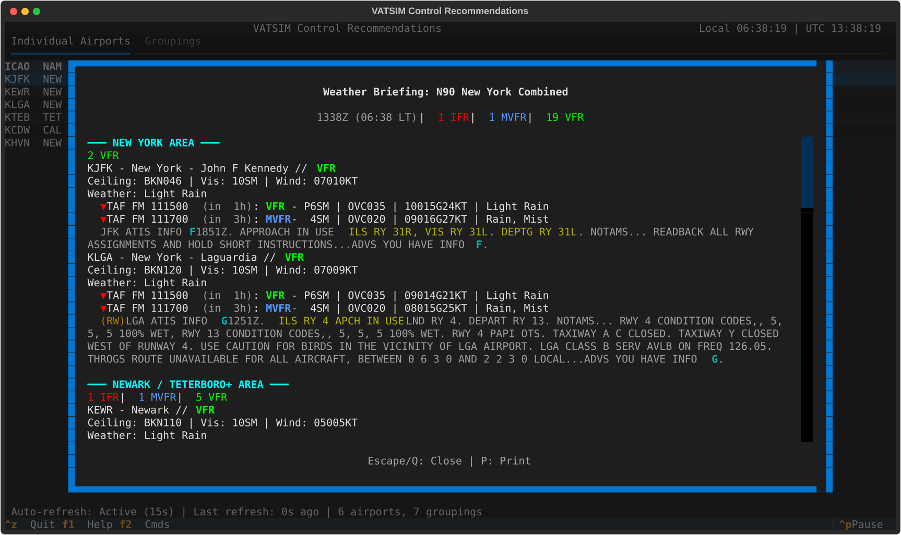

**For Airports/Groupings:**
- **METAR data** for each airport, with a `SPECI` flag for special reports
- **TAF data** (Terminal Aerodrome Forecast) when available
- **ATIS information** from VATSIM and real-world D-ATIS (fallback). The approach type (SIMUL ILS highlighted) and the runway assignments appear highlighted inside each card's ATIS text
- **Flight category summary** (counts of VFR/MVFR/IFR/LIFR over the airports that get a card; an airport with no METAR, or one the area grouping leaves out for lacking a position, is not counted), starting with the briefing time such as `0900Z (02:00 LT)`. Each area has its own summary too
- **TAF trend indicators**: the first two improving or worsening TAF changes per airport, marked `▲` or `▼` with the time, `(in 2h)`, the category and the visibility, ceiling, wind and weather

Airports are grouped into areas built around major airports and any airport with an ATIS, each named after one (for example `Sacramento Area`). Other airports join the nearest area, and airports with no METAR are left out. How many areas you get follows the number and spread of the major airports. A briefing for one requested airport puts it first under `━━━ REQUESTED ━━━`.

**Print to Browser:** Press `P` to export the briefing as HTML and open it in your default browser for printing or reference. The page is written to a temporary file named after the grouping or callsign and shows the Zulu generation time only; a toast says `Opened in browser: <file>`. If that file cannot be written, an error toast says why and nothing opens, and `P` with nothing loaded warns "No weather data to export". `Esc` or `Q` closes the briefing.

#### Flight Briefing

**Access:** Press `Ctrl+B` and pick a flight in the Go To picker (type `#` to list flights). Flight Info's `W` opens Route Weather instead, described below.

Provides a pilot-style weather briefing along the route:

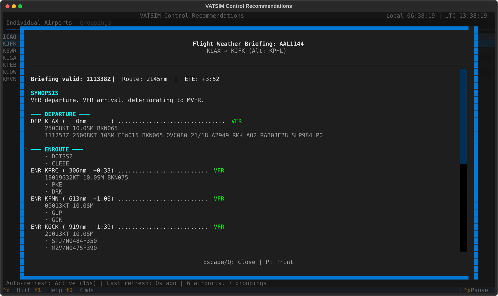

- **Synopsis** of departure, enroute, and arrival conditions
- **Departure weather** (METAR/TAF)
- **Enroute weather** (airports sampled every ~200nm along route)
- **Arrival weather** (METAR/TAF)
- **Alternate weather** if filed

Keys: `P` exports to the browser, `Q` or `Esc` closes.

#### Route Weather (from Flight Info)

**Access:** From flight info screen, press `W`

Shows weather along a flight's filed route by parsing waypoints. The header reads like `N waypoints parsed | 1 IFR | 4 VFR`.

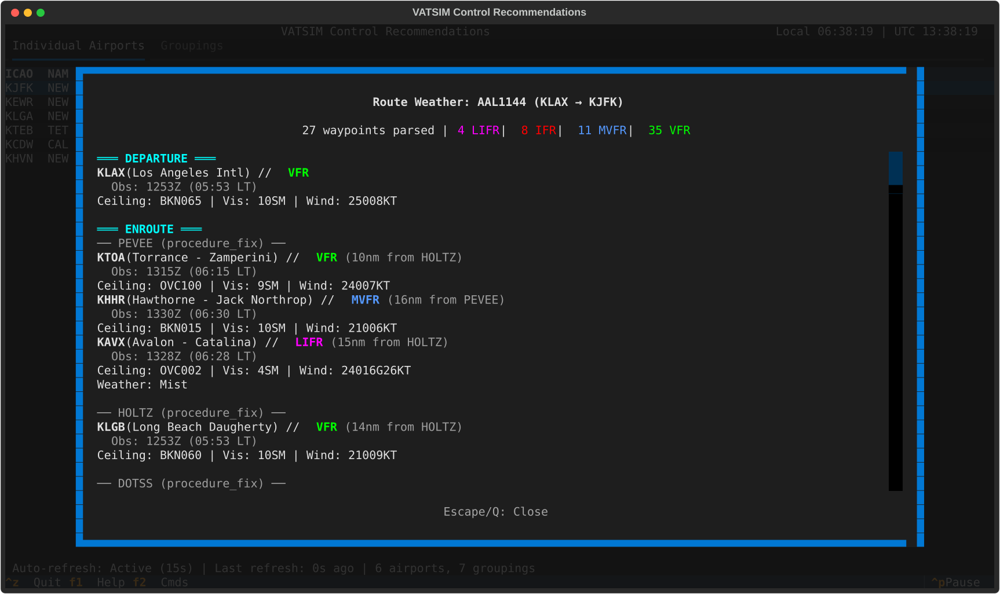

The body has DEPARTURE, ENROUTE and ARRIVAL sections. Under each filed fix (`── KIAD (FIX) ──`) the enroute section lists up to five airports within 30 nm of it. Each card shows the flight category, the observation time (`Obs: 1856Z (10:56 LT)`), ceiling, visibility, wind, any weather phenomena and the distance from the fix. Airports with no METAR are left out, and alternate-airport weather is not shown. `Esc` or `Q` closes.

---

### VFR Alternatives Finder

**Access:** `Ctrl+A`, or `Ctrl+A` from the METAR & TAF lookup, which fills the airport in

Find VFR or MVFR airports near an airport. Type an airport code and press `Enter`. The app checks airports within 100 nm, nearest first, with live progress (`Checking 12/80...`), and lists up to 10 that are VFR or MVFR.

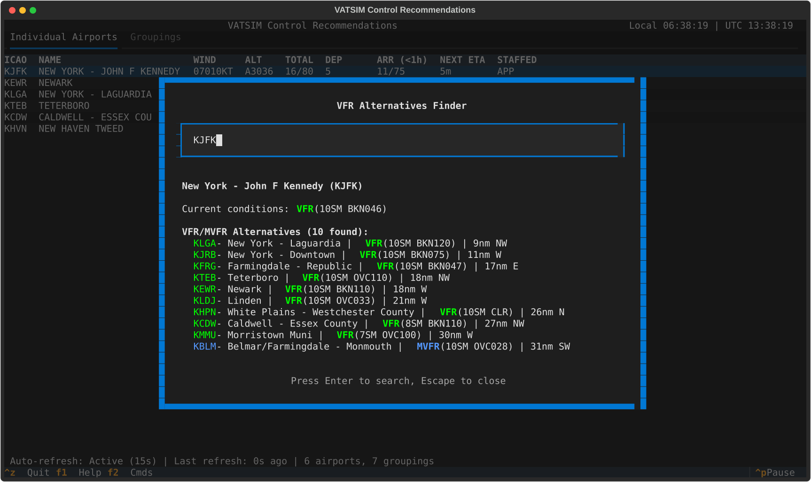

Each result reads like `KXXX - Name | VFR (10SM CLR) | distance direction`, and the top shows the searched airport's own conditions.

---

### Diversion Airport Finder

**Access:** From flight info screen, press `D`

Finds suitable diversion airports around the aircraft's present position, searching in rings of 25, 50, 75 and 100 nm (the range is fixed) and showing results as each ring finishes, up to 50 airports. The filed destination is never listed.

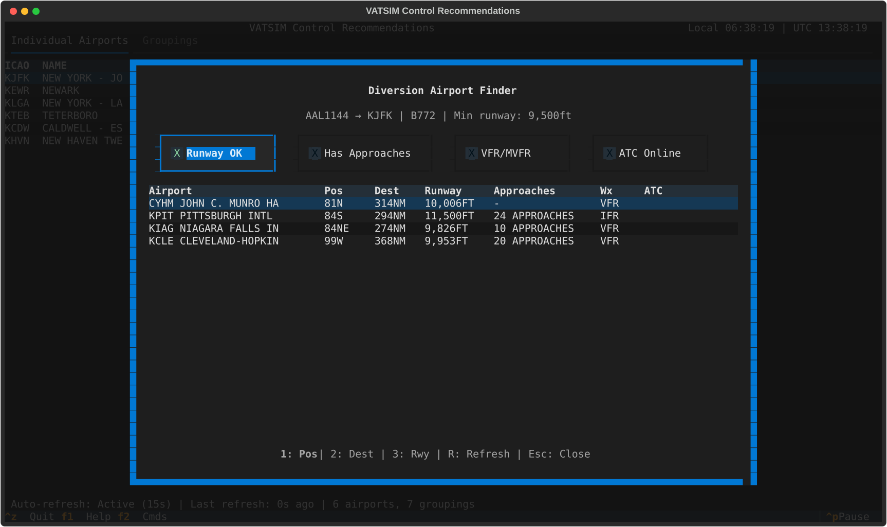

Columns:
- **Airport**
- **Pos**: distance and compass direction from the aircraft
- **Dest**: distance from the filed destination
- **Runway**: the longest
- **Approaches**: names, or a count
- **Wx**: flight category
- **ATC**: up to three online positions (`N/A` for airports without a tower)

The subtitle shows the flight, the aircraft type and the minimum runway the type needs. Four check boxes narrow the list: Runway OK (on by default), Has Approaches, VFR/MVFR and ATC Online.

**Diversion Modal Shortcuts:**
| Shortcut | Action |
|----------|--------|
| `R` | Refresh data |
| `1` | Sort by position |
| `2` | Sort by destination |
| `3` | Sort by runway |
| `Escape` | Close |

---

### Historical Flight Statistics

**Access:** `Ctrl+S` (not while another screen is open)

View historical traffic patterns between airports using data from statsim.net.
Enter one or more airport ICAO codes to see which of your tracked airports have
the most departures and arrivals to/from those airports over the last 90 days.

It needs tracked airports (see [Quick Start](#quick-start)); while you track everything it says "No airports are currently being tracked". Results fill in as the queries finish (`Fetching historical data... n/N queries`) in a table of ICAO, Name, Deps, Arrs and Total, and unknown codes are skipped with a note.

**Requires a free API key from statsim.net:**
1. Get a key at https://statsim.net/api-keys
2. Create a `.env` file in the application directory with:
   ```
   STATSIM_API_KEY=your-key-here
   ```
   Or set the `STATSIM_API_KEY` environment variable directly.

**Historical Stats Shortcuts:**
| Shortcut | Action |
|----------|--------|
| `Enter` | Search |
| `C` | Copy results to clipboard |
| `Escape` | Close |

---

### Tracked Airports Manager

**Access:** `Ctrl+T`

View and manage all currently tracked airports. The header reads `Tracking specific airports (12 airports)` or `Tracking all airports with activity (all airports)`, and picked rows are marked `[✓]`.

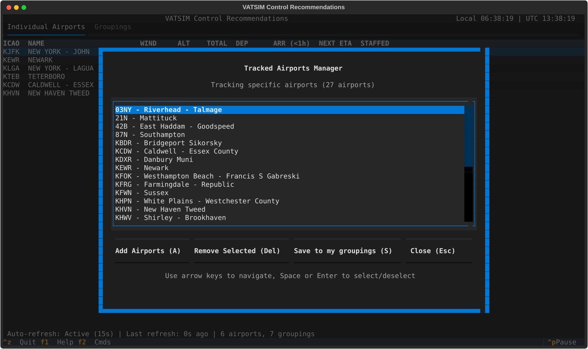

**Manager Shortcuts:**
| Shortcut | Action |
|----------|--------|
| `A` | Add airports (the quick add/remove dialog) |
| `Delete` | Remove the picked airport(s); nothing happens when none is picked |
| `Space` or `Enter` | Pick/unpick the highlighted airport |
| `S` | Save to my groupings: open the [Grouping Builder](#grouping-builder) on the picked airports (or the whole list when none is picked) |
| `Escape` | Close manager |

The buttons are Add Airports (`A`), Remove Selected (`Delete`), Save to my groupings (`S`) and Close (`Escape`). Changes reach the app when you close the manager: the tables refresh and Go To is rebuilt. `S` with an empty list says "No airports to save (tracking all airports)"; after a save the status line reads `Saved 'X' with N airports`.

**Adding Airports:**
`A` opens the "Quick Add/Remove Airports" dialog. Type four-letter codes, each with a `+` or `-`:
- `+KSFO +KOAK` - Add airports
- `-KSJC -KMRY` - Remove airports
- Mix additions and removals in one command

`Enter` applies and `Escape` cancels. If a token lacks the `+` or `-` or is not a four-letter code, the dialog lists the errors and applies nothing.

While you are tracking all airports, the quick-add `+` does nothing; start the app with a filter to track specific airports.

---

### Command Palette

**Access:** `F2`

A searchable list of the available commands (similar to VS Code), including Open Flight Board:
- Type to filter commands by name or shortcut
- Press `Enter` to execute
- Shows each command's keyboard shortcut in brackets

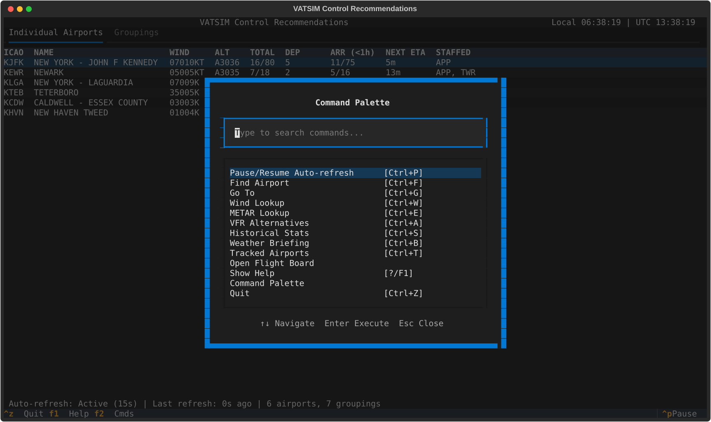

---

## Groupings file (custom_groupings.json)

The groupings file lets you organize airports into logical groups (e.g., by sector, region, or facility). The groupings it defines are listed with the presets, in the Groupings tab and in Go To.

### Location

There are two files. `data/custom_groupings.json` in the install folder ships a few (such as `FAT_APP`, `P80` and `S46`). An optional `custom_groupings.json` in your user data folder (the folder listed under [My groupings](#my-groupings)) holds your own, and its entries override the install file's by name.

Put your own entries in the user data folder file so updates never overwrite them.

### Format

The names below are examples of your own file, not shipped groupings:

```json
{
  "Bay Area": ["KSFO", "KOAK", "KSJC", "KHWD", "KPAO"],
  "SoCal": ["KLAX", "KSAN", "KONT", "KBUR", "KSNA"],
  "California": ["Bay Area", "SoCal"]
}
```

### Nesting Groupings

Groupings can contain other groupings! In the example above, "California" contains both "Bay Area" and "SoCal", which are recursively expanded.

### Preset Groupings

The application includes preset groupings in `data/preset_groupings/` organized by ARTCC (23 US ARTCCs), such as `O90`, `FAT` and `NCT Combined`. These are loaded automatically.

### ARTCC Groupings

Auto-generated groupings like "ZOA All", "ZLA All" contain all airports in that ARTCC.

### Name Clashes

When two sources use the same name, the later one wins, lowest to highest: ARTCC "All" groupings, presets, the groupings files, your ★ groupings.

### Creating Groupings from UI

1. Use the Tracked Airports Manager (`Ctrl+T`)
2. Pick the airports you want (or pick none to use the whole list)
3. Press `S` to open the [Grouping Builder](#grouping-builder)
4. Enter a name for the grouping and press `Ctrl+S`

### Creating Groupings from Go To

1. Open Go To (`Ctrl+G`)
2. Press `Tab` to enter multi-select mode
3. Select airports and groupings
4. Press `Ctrl+S` to open the [Grouping Builder](#grouping-builder) on your picks, then name and save it (see [My groupings](#my-groupings))

---

## My groupings

My groupings are the groupings you save yourself: multi-airport selections that appear in the Go To modal under "★ MY GROUPINGS" and with a star prefix in search results. Unlike the groupings in the groupings file, which are plain airport lists, a ★ grouping supports per-airport dep/arr filtering.

### Saving a ★ Grouping

1. Open Go To (`Ctrl+G`)
2. Press `Tab` to enter multi-select mode
3. Select airports, groupings, or a mix
4. Optionally press `F` on items to set dep/arr filters
5. Press `Ctrl+S` to open the [Grouping Builder](#grouping-builder), enter a name and press `Ctrl+S` again

### Using My Groupings

My groupings have their own "★ MY GROUPINGS" section at the top of Go To, alphabetical within it; on the Groupings tab they are listed like any grouping. `--groupings` accepts their names too.

Select one and press `Enter` to open a flight board showing only the selected airports (with filters applied). A ★ grouping opens its board with the saved dep/arr filters from Go To or the Groupings tab; presets and groupings from the groupings file open unfiltered.

On the board press `F` to cycle the direction; if the saved filters are mixed, `CUSTOM FILTER` is the first stop so you can cycle back to it. The saved grouping is never changed by cycling.

### Managing My Groupings

- **Edit**: Highlight a ★ grouping in Go To and press `E` to edit it in the [Grouping Builder](#grouping-builder)
- **Delete**: Highlight a ★ grouping and press `Ctrl+D` to delete it, after a confirmation

### Per-Airport Filtering

In Go To's pick several, press `F` on a picked airport to cycle its filter; in the Grouping Builder, press `F` on a member airport:
- Both departures and arrivals (default)
- Departures only (`[D▸]` in Go To, `dep` in the builder)
- Arrivals only (`[◂A]` in Go To, `arr` in the builder)

My groupings are stored in `favorites.json` in your user data folder: `%LOCALAPPDATA%\VATSIMControlRecs` on Windows, `~/Library/Application Support/VATSIMControlRecs` on macOS, `~/.local/share/VATSIMControlRecs` on Linux.

---

## Weather Data Sources

### METAR Source (Default)

```bash
uv run main.py --wind-source metar
```

- Uses Aviation Weather Center (aviationweather.gov)
- Standard METAR observations
- Updated approximately every hour (or more frequently at busy airports)
- 60-second cache to reduce API calls; an airport with no METAR is checked at most once per 60 seconds, and failed requests are retried on the next refresh

### Minute Source

```bash
uv run main.py --wind-source minute
```

- Uses weather.gov
- Up-to-the-minute wind observations
- More frequent updates than METAR
- Useful for rapidly changing conditions

`--wind-source` changes only the airports table's WIND column and the flight board title. The wind lookup (`Ctrl+W`) always shows both sources.

### D-ATIS Integration

Weather briefings, the METAR & TAF lookup and the board change toasts also pull ATIS information from two sources:
- **VATSIM ATIS**: ATIS broadcast by VATSIM controllers
- **Real-world D-ATIS**: Fallback to FAA D-ATIS when VATSIM ATIS is unavailable

---

## Visual Features

### Split-Flap Animations

The application features split-flap display animations (like airport departure boards):
- Characters flip through intermediate values when updating
- Different character sets for different columns (ETAs count down, codes flip alphabetically)
- Staggered delays create a wave effect
- Performance optimized (skips off-screen rows)
- A refresh updates the tables in place: rows keep their slots and only changed cells flap, new rows flap in at the bottom, and rows past the new count flap to blank and then disappear (immediately with `--disable-animations`)
- The cursor and scroll stay on the same airport or grouping after a refresh
- Columns widen when an update brings a wider value and shrink back once the flaps finish or rows are removed

**Disable animations:**
```bash
uv run main.py --disable-animations
```

### Notification Toasts

Boards for a grouping show a toast when a member airport's flight category, runways in use or approach type changes; see [Flight Boards](#flight-boards).

---

## Tips & Tricks

### Efficient Monitoring

1. **Use groupings** to organize airports by sector or facility
2. **Enable `--include-all-staffed`** to see positions even at quiet airports
3. **Pause auto-refresh** (`Ctrl+P`) when analyzing specific flights
4. **Save my groupings** with per-airport filters for quick access to common views

### Quick Navigation

1. Use `Ctrl+G` (Go To) for fastest navigation to any airport, flight, or grouping
2. Use filter prefixes (`@`, `#`, `$`) to narrow searches
3. Press `Enter` directly from the main table to open flight boards
4. Use the command palette (`F2`) to discover available commands

### Weather Analysis

1. Open sector weather briefings (`Ctrl+B`) from a grouping's board for comprehensive coverage
2. Use VFR alternatives finder (`Ctrl+A`) to suggest diversions to VFR pilots
3. Check route weather (`W` from flight info) to anticipate pilot requests
4. Weather briefings show the approach type and runway assignments from ATIS

### Performance

1. **Disable animations** for faster updates on slower systems
2. **Filter airports** rather than tracking entire countries for better responsiveness
3. **Increase refresh interval** (`--refresh-interval 30`) to reduce API calls

### Common Workflows

**Sector Controller:**
1. Start with your sector grouping: `uv run main.py --groupings "NCT Combined"`
2. Or save a ★ grouping with per-airport dep/arr filtering via Go To
3. Use `Ctrl+B` from the grouping's board for a sector weather briefing
4. Monitor flight boards for specific airports

**Approach Controller:**
1. Track your approach airports: `uv run main.py --airports KSFO KOAK KSJC`
2. Use `--include-all-staffed` to see when tower/ground positions open
3. Check VFR alternatives when weather deteriorates

**Flight Following:**
1. Use Go To (`Ctrl+G`) to find specific flights by callsign
2. Press `W` to view route weather
3. Press `D` to find diversion airports if needed
4. Press `C` to copy route to clipboard

---

## Troubleshooting

### "Command not found: uv"

Install uv ([instructions](https://docs.astral.sh/uv/getting-started/installation/)), then open a new terminal so it is on your PATH.

### Dependency Installation Fails

`uv run` installs the locked dependencies on first start. If that fails:

1. **Check internet**: dependencies come from PyPI, and the spaCy model from its GitHub release
2. **Re-sync by hand** to see the full error: `uv sync`
3. **Rebuild the environment**: delete the `.venv` directory and run `uv run main.py` again

If the app reports that the spaCy model `en_core_web_sm` is missing, run `uv sync`: the model is a locked dependency and is never downloaded at runtime.

### Display Issues

- Ensure your terminal supports UTF-8
- Use a modern terminal (Windows Terminal, iTerm2, etc.)
- Try increasing terminal size (minimum 80x24 recommended)
- On Windows, Windows Terminal is strongly recommended over CMD

### No Data Appearing

1. Check internet connectivity
2. VATSIM API may be temporarily unavailable
3. Check that auto-refresh is not paused (`Ctrl+P` toggles it), then wait for the next refresh
4. Check the debug logs in the `logs` folder of the user data directory (see Debug Logs below)

### A Grouping Name I Typed Is Ignored

`--groupings` prints a warning at start-up for each name it cannot find, and if none match the app tracks every airport. Names must match a preset, ARTCC grouping, groupings-file entry or ★ grouping exactly, ignoring case.

### Go To Shows No Airports, or Historical Statistics Says Nothing Is Tracked

You are tracking every airport. Start with `--airports`, `--groupings` or `--countries`, or add airports in the Tracked Airports Manager (`Ctrl+T`).

### "Auto-paused" in the Status Bar

This is normal while you move around; refreshes resume 3 seconds after you stop.

### Slow Performance

1. Reduce tracked airports or use specific groupings
2. Enable `--disable-animations`
3. Increase `--refresh-interval` to reduce API calls

### Debug Logs

Debug information is written to `debug_YYYYMMDD.log` in the `logs` folder of the user data directory: `%LOCALAPPDATA%\VATSIMControlRecs\logs` on Windows, `~/Library/Application Support/VATSIMControlRecs/logs` on macOS, `~/.local/share/VATSIMControlRecs/logs` on Linux.

Logs older than 10 days are automatically cleaned when the app starts. `--help` or an invalid argument creates no log folder. If the log file cannot be created, the app keeps running and prints `vatsim_debug: cannot write log file <path>: <error>` to stderr.

---

## Version Information

- **Application**: VATSIM Control Recommendations
- **Framework**: Textual (Terminal UI)
- **Data Sources**: VATSIM API, Aviation Weather Center, weather.gov, D-ATIS (FAA), StatsIM

For bug reports and feature requests, please open an issue on the project repository or join the [Discord](https://discord.gg/TR3FSpzvvp).
